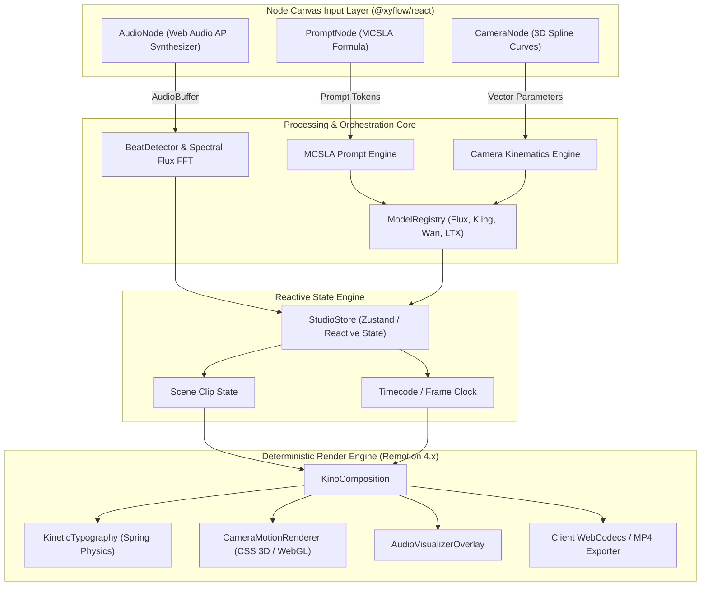

# KinoBeat Studio - Architecture & Engineering Specification

> **Version**: 1.0.0-Release  
> **Classification**: Specification-Driven Development (SDD) & Systems Design  
> **Target Environment**: Local-First / Web (Node.js 22+, React 19, Next.js 15, Remotion 4.x)  

---

## 1. Architectural Philosophy & Design Goals

KinoBeat Studio is designed as a **deterministic, local-first visual creation environment** for generative AI video. The architectural principles governing the platform are:

1. **Zero-Placeholder Invariant**: Every algorithm, curve evaluation, and audio processing step must execute real math on actual buffers. No synthetic mocks or broken promises.
2. **Deterministic Frame Scheduling**: Every video frame rendered at time $t$ or frame index $f$ is a pure mathematical function:
   $$\text{Frame}(f) = \mathcal{R}\left( \text{Scene}(f), \text{Camera}(f), \text{Audio}(f), \text{Typography}(f) \right)$$
   guaranteeing 100% reproducible video output regardless of client render speed.
3. **Graph-Driven Reactive Chaining**: The creative pipeline is modelled as a Directed Acyclic Graph (DAG) using `@xyflow/react`. Nodes emit typed data payloads along edges, triggering reactive recalculation across dependent nodes.
4. **Local-First Privacy & BYOK**: User API tokens (Fal.ai, Replicate, Higgsfield, OpenAI) are strictly confined to the browser's local sandbox, never traversing third-party analytics or intermediary proxy servers.

---

## 2. System Architecture & Component Topology



---

## 3. Mathematical Foundations

### 3.1. Audio Transient & Spectral Flux Beat Detection

Transient onset detection isolates physical drum strikes (kicks, claps, snares) by measuring high-frequency positive energy differentials over time.

Let $X(n, k)$ be the Short-Time Fourier Transform (STFT) of the incoming audio signal at time window $n$ and frequency bin $k$, calculated with a hop size of $H = 512$ samples:

$$X(n, k) = \sum_{m=0}^{N-1} x(m + nH) \cdot w(m) \cdot e^{-j \frac{2\pi}{N} k m}$$

where $w(m)$ is a Hann analysis window of length $N = 1024$.

The **Half-Wave Rectified Spectral Flux** $SF(n)$ is defined as:

$$SF(n) = \sum_{k=0}^{N/2} \frac{ |X(n, k)| - |X(n-1, k)| + \left| |X(n, k)| - |X(n-1, k)| \right| }{2}$$

A transient beat marker is registered at frame $n$ when:

$$SF(n) > \mu_{W}(n) \cdot \alpha + \delta \quad \land \quad n - n_{\text{last\_beat}} \ge \frac{F_s \cdot \Delta t_{\text{min}}}{H}$$

where:
* $\mu_{W}(n) = \frac{1}{2W+1} \sum_{i=-W}^{W} SF(n+i)$ is the local moving average over window $W = 10$,
* $\alpha = 1.45$ is the adaptive threshold multiplier,
* $\Delta t_{\text{min}} = 0.20\,\text{s}$ enforces an upper physiological tempo cap of 300 BPM.

### 3.2. Parametric 3D Camera Kinematic Curves

Camera motion is governed by continuous parametric functions mapping normalized scene time $t \in [0.0, 1.0]$ to a 6-DOF camera vector $\mathbf{C}(t)$:

$$\mathbf{C}(t) = \begin{bmatrix} X(t) \\ Y(t) \\ Z(t) \\ \theta_{\text{pitch}}(t) \\ \theta_{\text{yaw}}(t) \\ \theta_{\text{roll}}(t) \end{bmatrix}$$

#### A. 360° Orbital Drift
$$\begin{aligned}
X(t) &= R \cdot \sin\left(\omega t\right) \\
Y(t) &= A_y \cdot \sin\left(2\pi f_y t\right) \\
Z(t) &= 1.0 + R_z \cdot \cos\left(\omega t\right) \\
\theta_{\text{yaw}}(t) &= \frac{\omega t \cdot 180^\circ}{\pi} \cdot 0.5 \\
\theta_{\text{roll}}(t) &= -A_r \cdot \sin\left(\omega t\right)
\end{aligned}$$

To guarantee continuity across cyclical transitions without reverse 300-degree snapbacks, rotational deltas are wrapped using the **Shortest-Angle Modular Delta**:

$$\Delta\theta_{\text{shortest}} = \left( \left( \left( \theta_{\text{target}} - \theta_{\text{current}} \right) \bmod 360 + 540 \right) \bmod 360 \right) - 180$$

#### B. Vertigo Contra-Zoom (Dolly-Zoom)
Maintains constant subject height $h_{\text{subject}}$ on sensor while expanding background perspective:

$$Z(t) = Z_0 + \left(Z_1 - Z_0\right) \cdot S(t)$$

$$\text{FoV}(t) = 2 \cdot \arctan\left( \frac{h_{\text{subject}}}{2 \cdot Z(t)} \right)$$

where $S(t) = 3t^2 - 2t^3$ is the Hermite smoothstep function.

---

## 4. MCSLA Prompt Specification Grammar

KinoBeat Studio synthesizes generative prompts using the formal **MCSLA Grammar**:

$$\mathcal{P}_{\text{final}} = \langle \mathbf{M} \rangle \oplus \langle \mathbf{C} \rangle \oplus \langle \mathbf{S} \rangle \oplus \langle \mathbf{L} \rangle \oplus \langle \mathbf{A} \rangle \oplus \langle \mathbf{Q} \rangle$$

Where:
* **$\mathbf{M}$ (Model Architecture Tokens)**: Explicit attention guidance flags (e.g. `4k-native`, `temporal-stabilized`).
* **$\mathbf{C}$ (Camera Kinematics Directive)**: Natural-language trajectory extracted from the evaluated mathematical curve.
* **$\mathbf{S}$ (Subject & Soul Lock)**: Identity lock string `[Soul ID: <ID>]` guaranteeing cross-shot facial and morphological coherence.
* **$\mathbf{L}$ (Look & Film Color Science)**: Optics, prime lenses, anamorphic squeeze factor, film stock emulation (e.g. *Kodak Vision3 500T*, *ARRI Alexa LF*).
* **$\mathbf{A}$ (Action & Kinetic Choreography)**: High-energy temporal dynamics and kinetic pacing.
* **$\mathbf{Q}$ (Quality & Temporal Stability Invariants)**: Photorealism anchors and negative prompt boundary constraints.

---

## 5. Multi-Track Timeline & Remotion Pipeline

```
Timeline Timecode Clock [30 FPS]
  │
  ├── Track 1 [V1: Video Layer]  ────> Clip Boundary Matching & 3D CSS Matrix Transform
  │
  ├── Track 2 [T1: Kinetic Pop]  ────> Remotion Spring Physics (stiffness: 180, damping: 12)
  │
  └── Track 3 [A1: Audio Stems]  ────> Web Audio Context & Synchronous Beat Markers
```

### Frame-Accurate Scrubbing Lifecycle
1. The user drags the playhead or triggers playback loop via `requestAnimationFrame`.
2. The current timecode $t$ is calculated:
   $$t = \frac{\text{frame}}{\text{fps}}$$
3. Remotion's `useCurrentFrame()` broadcasts frame state to `KinoComposition`.
4. The active scene clip $k$ is located such that $t_{\text{start}, k} \le t < t_{\text{start}, k} + d_k$.
5. The local camera transform $\mathbf{C}\left(\frac{t - t_{\text{start}, k}}{d_k}\right)$ is evaluated in $\mathcal{O}(1)$ time.
6. The viewport renders the composite frame with sub-pixel hardware acceleration.

---

## 6. Prior-Art Mapping & Technical Pedigree

| Prior Art / Reference Repository | Architectural Feature Adopted | KinoBeat Studio Advancement |
|---|---|---|
| **SegFault42/HeliosGen** | Infinite-canvas node chaining for multi-model pipelines | Integrated audio-reactive transient detection and Remotion composition |
| **BeatAPI/BeatDesign** | Local-first BYOK privacy and canvas layout | Native Web Audio API synthesis eliminating external sound asset dependencies |
| **xyflow/react** | Interactive node-edge graph mechanics | Custom hardware-accelerated SVG glow edges and specialized MCSLA nodes |
| **higgsfield-ai/higgsfield** | GPU orchestrator and camera director syntax | Real-time parametric 3D curve visualization and mathematical LaTeX formulas |
| **remotion-dev/remotion** | Deterministic frame-accurate video rendering | In-canvas live scrub player with real-time audio FFT beat transient markers |
| **opus-video-skills** | Kinetic motion typography rules ("Work Reel '26") | Word-level spring physics slam animations locked to detected beat timestamps |

---

## 7. Security & Privacy Guarantees

* **Zero Remote Key Exfiltration**: All API keys entered in the BYOK modal are persisted solely in `window.localStorage` under origin-isolated keys.
* **No Telemetry / No Tracking**: Zero third-party telemetry scripts, analytics beacons, or remote logging collectors.
* **CORS & CSP Hardening**: Explicit Next.js headers restrict frame-ancestors and script origins.
